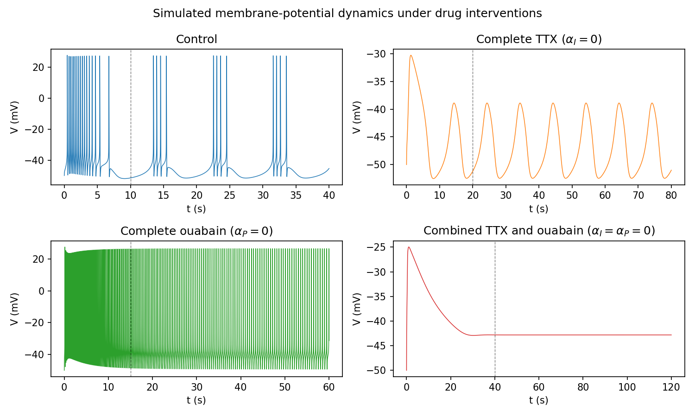
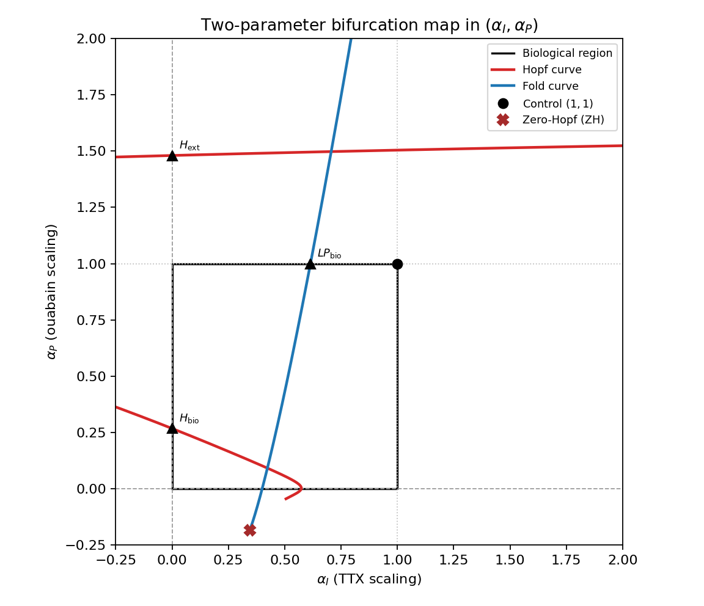

# Modelling Drug-Induced Changes in Bursting Dynamics of the *Aplysia* R15 Neuron

**MATH3888 Mathematics Capstone · University of Sydney · Semester 2, 2026**

This repository contains the computational work for a mathematics capstone project investigating how tetrodotoxin (TTX) and ouabain affect the dynamics of the *Aplysia* R15 neuron. Using the seven-dimensional Plant–Kim (1976) model, the project combines numerical simulation, equilibrium and stability analysis, and numerical bifurcation continuation to study the transition between bursting, non-spiking slow oscillations, regular firing, and resting behaviour.

The work was developed in the context of a **group research project**, alongside a separate **individual mathematical analysis** of the model's Jacobian and local bifurcation mechanisms. Numerical results are compared qualitatively with the experimental observations of Junge and Stephens (1973).

## Project overview

The R15 neuron exhibits endogenous bursting: clusters of action potentials separated by quieter intervals. The Plant–Kim model extends the Hodgkin–Huxley framework with additional ionic currents and slow gating dynamics to represent this behaviour.

We study two pharmacological interventions:

- **Tetrodotoxin (TTX)** inhibits the transient inward current responsible for fast action potentials, revealing a slower membrane oscillation.
- **Ouabain** inhibits the electrogenic pump current, changing the balance of membrane currents and the resulting activity.

Their effects are represented by two dimensionless parameters,

$$
g_I = \alpha_I g_I^{(0)}, \qquad
I_{\mathrm{ep}} = \alpha_P I_{\mathrm{ep}}^{(0)},
\qquad (\alpha_I,\alpha_P)\in[0,1]^2.
$$

Here, $(\alpha_I,\alpha_P)=(1,1)$ denotes the untreated model; setting either parameter to zero represents complete blockade of the corresponding current. At complete TTX blockade, two gating variables decouple from the other equations, allowing an exact five-dimensional reduction for comparison with the full system.

The main objective is to relate **qualitative changes in simulated neuronal activity** to the underlying structure of equilibria, periodic orbits, and their bifurcations. Drug scaling is a mathematical approximation of the interventions, not a detailed pharmacokinetic model.

## Computational approach

The investigation is organised into four parts:

1. **Baseline and drug-response simulations.** Implement the seven-dimensional model; verify untreated bursting; test robustness to initial conditions and numerical settings; simulate untreated, TTX, ouabain, and combined-drug endpoints.
2. **Parameter sweeps and equilibrium stability.** Vary drug-strength parameters, locate equilibria, and examine Jacobian eigenvalues alongside time-domain simulations.
3. **Numerical bifurcation analysis.** Use PyDSTool for one-parameter equilibrium continuation (`EP-C`), AUTO-backed periodic-orbit continuation (`LC-C`), and two-parameter fold (`LP-C`) and Hopf (`H-C2`) continuation in the $(\alpha_I,\alpha_P)$ plane.
4. **Local mathematical analysis (individual component).** Construct and validate the full symbolic $7\times7$ Jacobian, investigate saddle-node nondegeneracy and Hopf transversality, and compare local theoretical predictions with numerical continuation.

The analysis distinguishes the biologically motivated parameter square $[0,1]^2$ from **extended mathematical continuation ranges**. In particular, equilibrium bifurcation curves do not on their own classify the full bursting or beating dynamics; those interpretations also require time traces and, where available, periodic-orbit calculations.

## Selected visualisations

### Simulated activity under the drug interventions



*Numerical membrane-voltage trajectories from the Plant–Kim model under four parameter conditions. These are model simulations, not experimental recordings.*

### Two-parameter bifurcation structure



*Fold and Hopf continuation in the drug-strength parameter plane. The biologically motivated region is $[0,1]^2$; continuation may also reveal mathematically relevant features outside this region.*

Additional report-ready figures are available in [`ReportFigs/`](ReportFigs/), with numerical data and diagnostic plots under [`outputs/`](outputs/).

## Individual mathematical component

The separate individual study investigates the **local mechanisms behind selected bifurcation points**, rather than only identifying them through software continuation. In particular, it examines a saddle-node point on the TTX parameter slice and a Hopf point on the ouabain slice under complete TTX.

The analysis includes:

- Building the full symbolic Jacobian with **SymPy** and cross-validating it against finite-difference and continuation-based calculations.
- Examining critical eigenvalues and the near-singularity of the Jacobian at the saddle-node point.
- Evaluating saddle-node nondegeneracy conditions using left/right null vectors and second derivatives of the vector field.
- Testing Hopf transversality through changes in the real part of the critical eigenvalue pair.
- Comparing the linearised Hopf period $T_{\mathrm{lin}}=2\pi/\mathrm{Im}(\lambda_H)$ with periods obtained from AUTO continuation near onset.

See [`notebooks/08_jacobian_hopf_local_analysis.ipynb`](notebooks/08_jacobian_hopf_local_analysis.ipynb), [`src/plant_kim_jacobian.py`](src/plant_kim_jacobian.py), and the [individual analysis report](group13-530598916.pdf).

## Repository guide

| Location | Contents |
| --- | --- |
| [`notebooks/`](notebooks/) | Main computational narrative, from baseline implementation through bifurcation analysis |
| [`src/`](src/) | Reusable Plant–Kim model, analysis helpers, exact TTX reduction, and symbolic Jacobian |
| [`scripts/`](scripts/) | Continuation engines, numerical analysis scripts, and notebook/figure preparation utilities |
| [`outputs/`](outputs/) | Saved numerical tables, continuation data, and diagnostic figures |
| [`ReportFigs/`](ReportFigs/) | Curated figures used for reporting and presentation |
| [`Notes/`](Notes/) | Model specification, mathematical notes, and development checklists |
| [`References/`](References/) | Source literature and background reading |
| [`Other/`](Other/) | Project reports, supporting documents, and earlier drafts |
| [`Code/`](Code/) and [`Labs/`](Labs/) | Course examples and PyDSTool practice material; not all are original project analyses |

### Main notebooks

| Notebook | Focus |
| --- | --- |
| [`01_baseline_model.ipynb`](notebooks/01_baseline_model.ipynb) | Implement and validate untreated R15 bursting |
| [`02_robustness_phase_planes.ipynb`](notebooks/02_robustness_phase_planes.ipynb) | Robustness checks and phase-plane projections |
| [`03_drug_endpoints.ipynb`](notebooks/03_drug_endpoints.ipynb) | TTX, ouabain, combined blockade, and 7D/5D comparison |
| [`04_parameter_sweeps_equilibria.ipynb`](notebooks/04_parameter_sweeps_equilibria.ipynb) | Drug-parameter sweeps, equilibria, and local stability |
| [`05_ttx_bifurcation.ipynb`](notebooks/05_ttx_bifurcation.ipynb) | One-parameter TTX continuation |
| [`06_ouabain_bifurcation.ipynb`](notebooks/06_ouabain_bifurcation.ipynb) | Ouabain continuation, including complete-TTX conditions |
| [`07_two_parameter_bifurcation.ipynb`](notebooks/07_two_parameter_bifurcation.ipynb) | Two-parameter fold and Hopf bifurcation curves |
| [`08_jacobian_hopf_local_analysis.ipynb`](notebooks/08_jacobian_hopf_local_analysis.ipynb) | Individual Jacobian, saddle-node, and Hopf analysis |

The canonical seven-dimensional equations and parameters are specified in [`Notes/model.md`](Notes/model.md) and implemented in [`src/plant_kim_model.py`](src/plant_kim_model.py). The notebook sequence is the best starting point for understanding the analysis.

## Software and reproducibility

**Core tools:** Python 3.9, NumPy, SciPy, Matplotlib, SymPy, Jupyter, PyDSTool, and AUTO (for periodic-orbit and advanced continuation).

The repository contains a [`requirements-lock.txt`](requirements-lock.txt) snapshot of the working local Python environment. The original setup used **Python 3.9.20** and a project-local `.venv` with the `Python 3.9 (PyDSTool)` Jupyter kernel. Because PyDSTool and AUTO have older platform-specific dependencies, the lockfile is a reference snapshot rather than a guarantee of cross-platform installation.

For an existing compatible local environment, launch JupyterLab from the repository root:

```bash
./.venv/bin/jupyter-lab
```

For AUTO-backed calculations, the repository also includes [`docker-compose.yml`](docker-compose.yml), using the `curuy/math3888:latest` image. **Before running Docker Compose, update its machine-specific bind-mount path and review the exposed Jupyter port/token settings.** The original workflow used the local environment for VODE simulations and most equilibrium calculations, and Docker for AUTO continuation.

Some notebooks display **saved CSVs and figures** generated by the corresponding scripts, rather than re-running expensive continuation automatically. For example, the two-parameter engine is [`scripts/run_07_two_parameter_bifurcation.py`](scripts/run_07_two_parameter_bifurcation.py), while the individual analysis uses the [`run_08_*`](scripts/) scripts and saved data under `outputs/data/jacobian_hopf/`. Reproducing the full pipeline therefore requires the appropriate environment and execution order; the repository is a research snapshot, not a packaged one-command application.

## Contributions and project context

This work formed part of a **collaborative MATH3888 capstone project**. My contributions centred on the computational investigation: implementation and validation of the Plant–Kim simulations, drug-response and bifurcation analysis, preparation of report figures, and writing of the computational-results material for the group report. The separate individual component developed the symbolic Jacobian and local saddle-node/Hopf analysis described above.

The [group report](group13-report.pdf) provides the broader biological motivation, experimental context, mathematical modelling, and discussion. Experimental traces cited in the project come from the published literature; the traces shown in this README are numerical simulations.

## Primary references

- Plant, R. E., & Kim, M. (1976). *Mathematical description of a bursting pacemaker neuron by a modification of the Hodgkin–Huxley equations.* **Biophysical Journal, 16**(3), 227–244. [https://doi.org/10.1016/S0006-3495(76)85683-4](https://doi.org/10.1016/S0006-3495(76)85683-4)
- Junge, D., & Stephens, C. L. (1973). *Cyclic variation of potassium conductance in a burst-generating neurone in Aplysia.* **The Journal of Physiology, 235**(1), 155–181. [https://doi.org/10.1113/jphysiol.1973.sp010382](https://doi.org/10.1113/jphysiol.1973.sp010382)
- Plant, R. E., & Kim, M. (1975). *On the mechanism underlying bursting in the Aplysia abdominal ganglion R15 cell.* **Mathematical Biosciences, 26**, 357–375.

*Academic research project, University of Sydney, 2026.*
